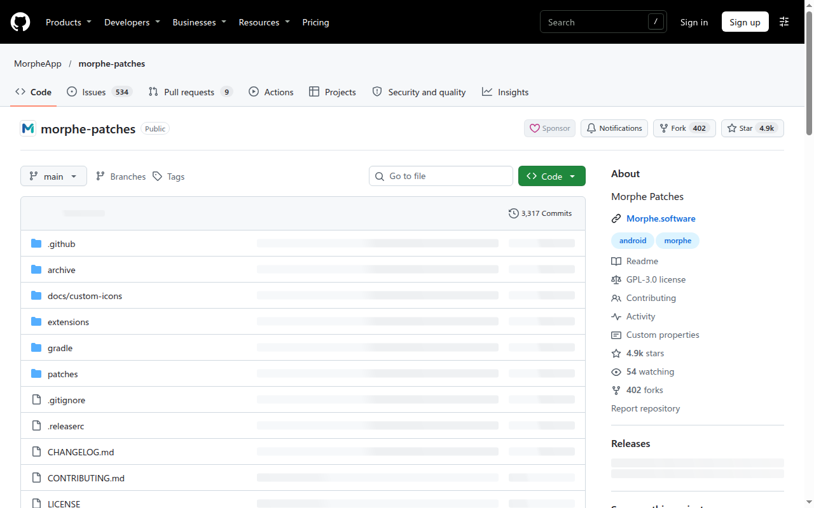
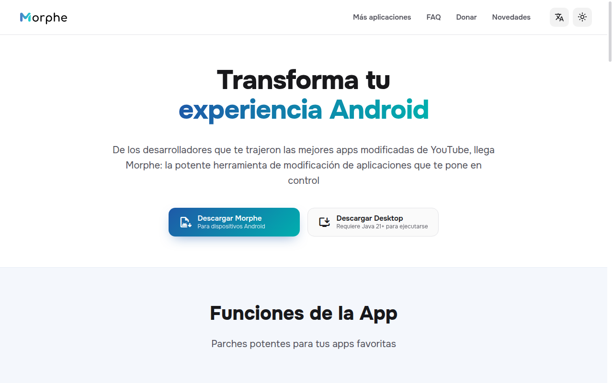

# 🎬 YouTube Morphe & MicroG-RE

### Compilaciones oficiales parcheadas para Android — Sin anuncios, reproducción en segundo plano y compatibilidad completa con cuentas Google.

 

 

[**📥 Descargar Última Versión (Releases)**](https://github.com/darwinsin822/youtube-morphe/releases) · [**Instrucciones de Instalación**](#-guía-de-instalación-paso-a-paso) · [**Capturas del Repositorio**](#-capturas-del-proyecto-morphe) · [**Créditos**](#-créditos-y-referencias)

---

## 📦 Contenido del Paquete

1. **YouTube Morphe Patched** (`YouTube-21.13.164-Morphe-Patched.apk`)
   - Versión base: `21.13.164`
   - Parches aplicados con motor Morphe / ReVanced:
     - 🚫 Bloqueo completo de publicidad en video, banners y shorts.
     - 🎧 Reproducción en segundo plano y con pantalla apagada.
     - ⏭️ SponsorBlock integrado (salta patrocinios, intros e intermedios automáticamente).
     - 📱 Modo PiP (Picture-in-Picture) nativo.
     - 🛠️ Soporte MicroG/GmsCore para sincronización e inicio de sesión.
2. **YouTube Music Morphe Patched** (`YouTubeMusic-9.15.51-Morphe-Patched.apk`)
   - Versión base: `9.15.51`
   - Parches aplicados:
     - 🎵 Reproducción exclusiva de audio sin restricciones de segundo plano.
     - 🚫 Sin anuncios de audio ni visuales.
3. **MicroG-RE Oficial** (`microg-7.3.1.apk`)
   - Versión: `7.3.1` (Última actualización oficial de [MorpheApp/MicroG-RE](https://github.com/MorpheApp/MicroG-RE))
   - Permite iniciar sesión con tu cuenta de Google sin necesidad de acceso root.

---

## 🚀 Guía de Instalación Paso a Paso

> [!IMPORTANT]
> **Orden estricto de instalación:**
> 1. Instala primero **`microg-7.3.1.apk`**.
> 2. Abre MicroG una vez (o ajusta la optimización de batería a "Sin restricciones" para evitar cierres).
> 3. Instala **`YouTube-21.13.164-Morphe-Patched.apk`** (y/o YouTube Music).
> 4. Abre YouTube Morphe e inicia sesión normalmente con tu cuenta Google.

---

## 📸 Capturas del Proyecto Morphe

### Repositorio Oficial de Morphe (`MorpheApp/morphe-patches`)

### Sitio Web Oficial (`morphe.software`)

---

## ⚖️ Créditos y Referencias

- **Morphe Team**: [MorpheApp en GitHub](https://github.com/MorpheApp) & [morphe.software](https://morphe.software)
- **MicroG-RE**: [MorpheApp/MicroG-RE](https://github.com/MorpheApp/MicroG-RE)
- **ReVanced Project**: Base de la ingeniería inversa y parches modulares comunitarios.
